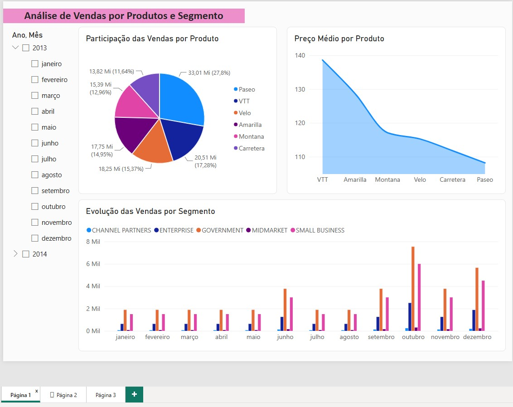
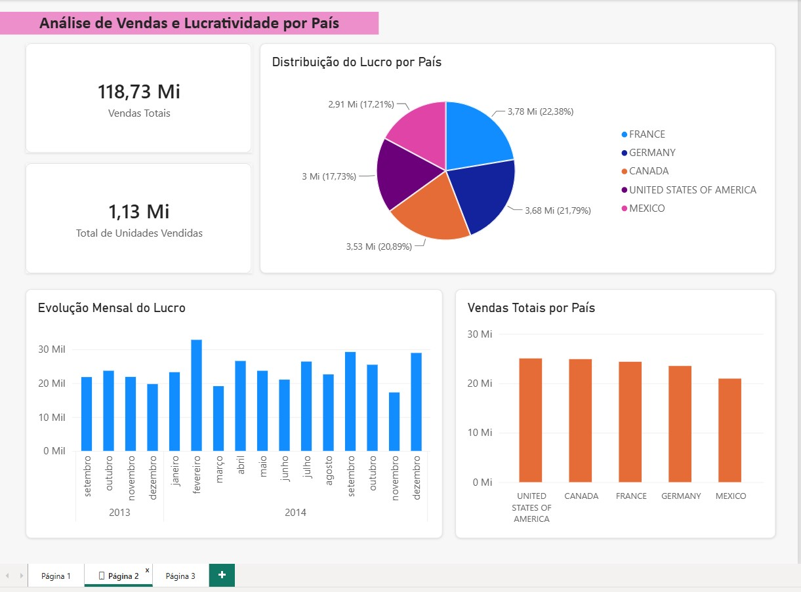
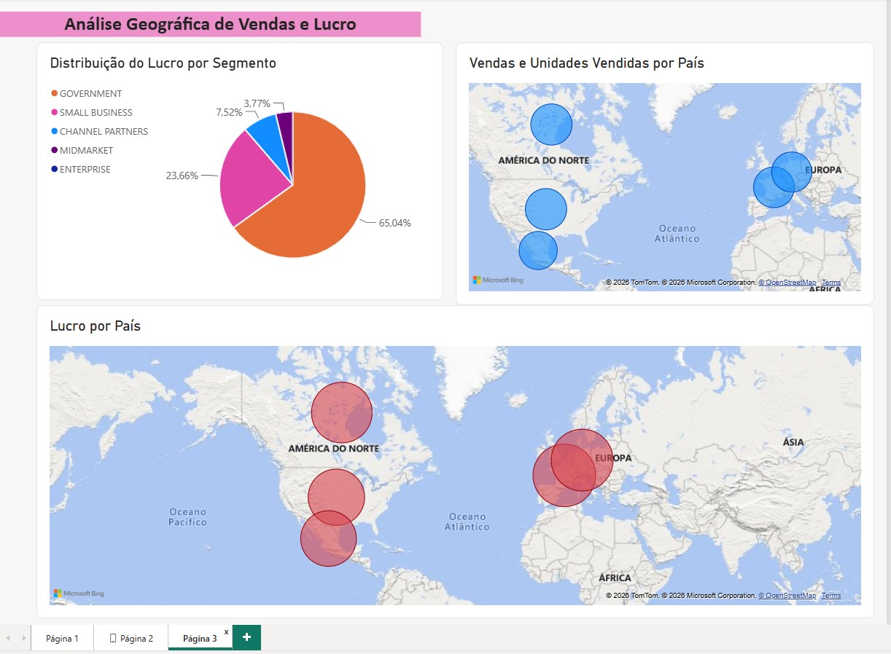

# 📊 Desafio 01 - Analisando Dados de um Dashboard de Vendas no Power BI

Projeto desenvolvido durante o curso **Santander Bootcamp Universia - Primeiros Passos em Power BI**, oferecido pela **Digital Innovation One (DIO)**.

Neste desafio foi realizada a reprodução de relatórios apresentados durante o curso e o desenvolvimento de uma página adicional de análise, aplicando conceitos de visualização e organização de dados no Power BI.

## 🎯 Objetivo

Desenvolver um dashboard interativo para análise de dados de vendas utilizando o Power BI, explorando diferentes tipos de visualizações e boas práticas na organização de relatórios.

## 🚀 Competências Desenvolvidas

- Importação de dados no Power BI;
- Transformação e tratamento de dados com Power Query;
- Criação de dashboards interativos;
- Utilização de gráficos, mapas e indicadores;
- Organização visual de relatórios;
- Análise de vendas, lucro e desempenho por segmento e país.

## 📄 Páginas Desenvolvidas

### Página 1 - Análise de Vendas por Produtos e Segmento

Contém visualizações para análise da participação das vendas por produto, preço médio dos produtos e evolução das vendas por segmento ao longo do tempo.

### Página 2 - Análise de Vendas e Lucratividade por País

Apresenta indicadores de vendas totais, total de unidades vendidas, distribuição do lucro por país, evolução mensal do lucro e vendas totais por país.

### Página 3 - Análise Geográfica de Vendas e Lucro

Página desenvolvida como proposta do desafio contendo:

- Vendas e unidades vendidas por país;
- Lucro por país;
- Distribuição do lucro por segmento;
- Ajustes nos títulos dos visuais;
- Organização do layout;
- Configuração de tooltips para enriquecer a análise.

## 📈 Resultados

O dashboard desenvolvido permite:

- Identificar os produtos com maior participação nas vendas;
- Comparar a lucratividade entre diferentes países;
- Analisar o desempenho dos segmentos de mercado;
- Visualizar a distribuição geográfica das vendas e do lucro;
- Apoiar a tomada de decisão por meio de indicadores visuais.

## 📸 Capturas de Tela

### Página 01 - Análise de Vendas por Produtos e Segmento

### Página 02 - Análise de Vendas e Lucratividade por País

### Página 03 - Análise Geográfica de Vendas e Lucro

---

## 📁 Arquivos do Projeto

| Arquivo | Descrição |
|----------|------------|
| Financial Sample.xlsx | Base de dados utilizada no projeto |
| Desafio 01 Dashboard de Vendas.pbix | Relatório desenvolvido no Power BI |
| Dashboard_vendas.pdf | Versão exportada do dashboard |
| Pagina-01.jpg | Captura da Página 1 |
| Pagina-02.jpg | Captura da Página 2 |
| Pagina-03.jpg | Captura da Página 3 |

---

## 🛠️ Tecnologias Utilizadas

- Power BI Desktop
- Power Query

## 📚 Referências

Os dados e materiais de apoio utilizados neste desafio tiveram como base o conteúdo disponibilizado por **Juliana Zanetto**:

🔗 https://github.com/julianazanelatto/power_bi_analyst

Este projeto foi desenvolvido para fins educacionais como parte das atividades propostas no curso **Santander Bootcamp Universia - Primeiros Passos em Power BI**, da DIO.

## 👩‍💻 Autora

**Silvana Campos**

Projeto desenvolvido para fins de estudo, prática e construção de portfólio em Power BI.
